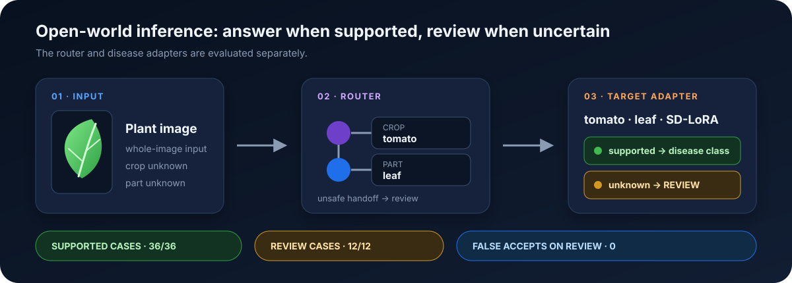
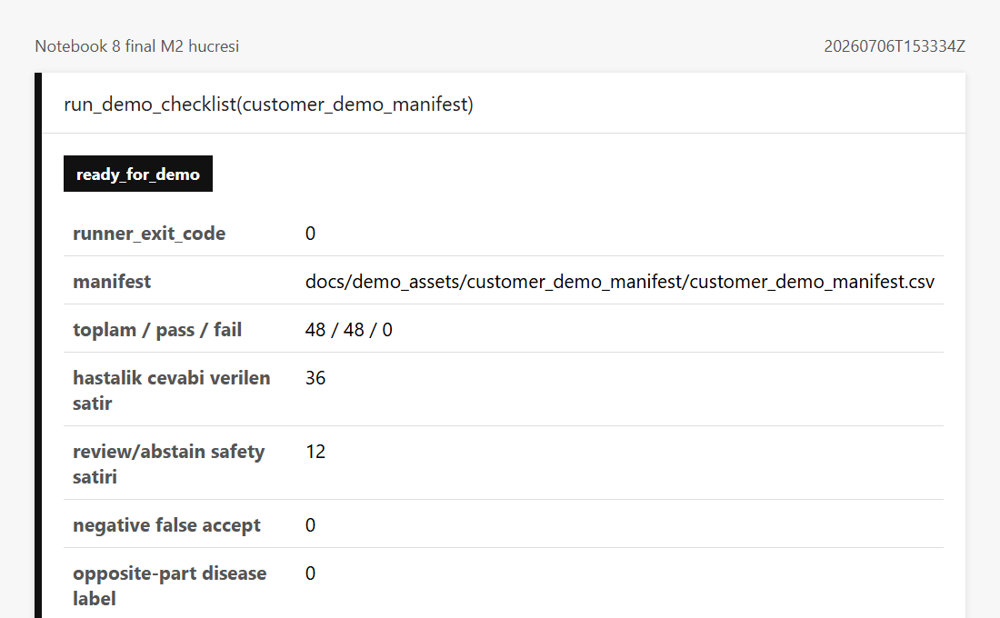

# AADS: Open-World Plant Disease Recognition

[](https://github.com/EfeErim/aads-open-world-plant-disease/actions/workflows/ci.yml)
[](pyproject.toml)
[](LICENSE)

A conventional plant-disease classifier has to return a label even when the photo shows the wrong crop, the wrong
plant part, or no plant at all. I built AADS so it can route an image to the right specialist model and send
unsupported inputs to review instead of bluffing.



> **Status: frozen.** This was my individual graduation project and is no longer under active model development. The
> released `aads-public-demo-v1.1.2` weights are the final artifacts. The fixed end-to-end regression replay passes;
> the production safety gate does not (0/8). The weights are research/demo artifacts, not a diagnostic product.

## What it does

AADS handles apricot, grape, strawberry and tomato images. A router (SAM3 regions scored by BioCLIP-2.5) identifies the
crop and plant part, then loads one of eight per-target LoRA adapters on a frozen
[DINOv3 ViT-L/16](https://github.com/facebookresearch/dinov3). The adapter returns a supported disease class or
`review`, using energy, feature-distance and kNN OOD scores calibrated per adapter.

Code and artifact names say `continual_sd_lora` because the released bundles depend on them; the adapters are
standard per-target LoRA adapters (see the [terminology note](docs/methodology_and_results.md#terminology-note)).

## Run it in Colab

Training and inference run in Google Colab; the notebooks clone the repository and install their own dependencies.
Model-backed cells need a Hugging Face token with access to the gated DINOv3 backbone.

| Goal | Notebook |
|---|---|
| Upload an image and get a router-to-adapter decision | [Notebook 8](https://colab.research.google.com/github/EfeErim/aads-open-world-plant-disease/blob/main/colab_notebooks/8_auto_router_adapter_prediction.ipynb) |
| Train one crop/part adapter | [Notebook 2](https://colab.research.google.com/github/EfeErim/aads-open-world-plant-disease/blob/main/colab_notebooks/2_train_continual_sd_lora_adapter.ipynb) |
| Audit and split your own dataset | [Notebook 0](https://colab.research.google.com/github/EfeErim/aads-open-world-plant-disease/blob/main/colab_notebooks/0_prepare_grouped_dataset_for_training.ipynb) |
| Reload and validate an exported adapter | [Notebook 3](https://colab.research.google.com/github/EfeErim/aads-open-world-plant-disease/blob/main/colab_notebooks/3_validate_exported_adapter_directly.ipynb) |

Notebook 8 downloads the public adapter bundles and checks them against a SHA-256 manifest. Notebook 2 can generate a
deterministic synthetic sample to exercise the pipeline; that sample is marked `production_eligible: false` and
supports no accuracy claim. Training images are not included because I could not verify redistribution rights for
every source.

## Results

**Fixed regression replay.** 48 images selected from rows that had already passed an earlier internal stress run;
two known regressions were excluded. The 100% pass rate follows from that selection rule: this checks that the frozen
pipeline reproduces known-good decisions end to end, not accuracy.

| 48-image manifest | Result |
|---|---:|
| Supported disease cases | **36 / 36** |
| Review/abstain cases | **12 / 12** |
| False accepts on review cases | **0** |
| Wrong-part disease labels | **0** |

<p align="center">
  
</p>

All 12 review rows are router-level rejections; adapter-level unknown-disease rejection is measured by the gate below.

**Per-adapter evaluation** on held-out test splits across the eight adapters: accuracy 0.899-0.994, balanced accuracy
0.836-0.994, macro-F1 0.810-0.993. The behavioral-acceptance gate, which also requires minimum sample counts, low
false rejection and rejection of same-crop unknown diseases, passes **0/8**. The system should not be used for
autonomous diagnosis.

Evidence is checked in under [`evidence/`](evidence/) (`controlled_demo_summary.json`, `controlled_demo_rows.json`,
`latest_behavioral_acceptance_summary.json`); a unit test rebuilds the acceptance summary from the eight per-target
records and fails if they disagree. [Methodology and results](docs/methodology_and_results.md) covers the evaluation
design, per-adapter failures, literature and limits.

## Code

| Area | Entry point |
|---|---|
| Inference | [`src/workflows/inference.py`](src/workflows/inference.py) |
| Training | [`src/workflows/training.py`](src/workflows/training.py) |
| Crop/part routing | [`src/router/router_pipeline.py`](src/router/router_pipeline.py) |
| Router-to-adapter handoff | [`src/pipeline/router_adapter_runtime.py`](src/pipeline/router_adapter_runtime.py) |
| OOD scoring | [`src/ood/continual_ood.py`](src/ood/continual_ood.py) |

Notebooks run thin cell scripts from `scripts/notebook_cells/` that call `src/`. [Architecture](docs/architecture.md)
describes the config, data layouts, decision statuses and output files.

Local development (Python 3.11):

```bash
pip install -e ".[dev]"
ruff check src scripts tests && pytest --runintegration
```

## License

The source code is released under the [MIT License](LICENSE). Each DINOv3-derived adapter bundle also includes the
applicable upstream DINOv3 license.
